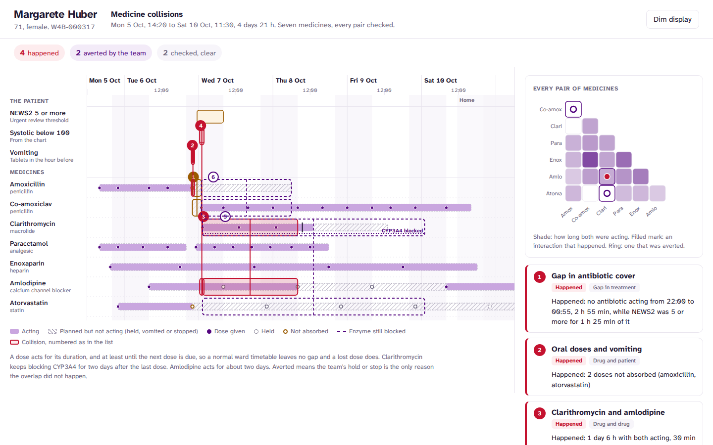
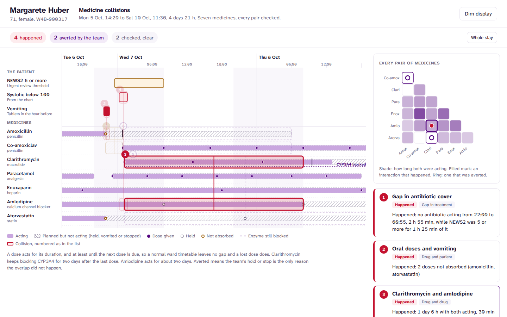
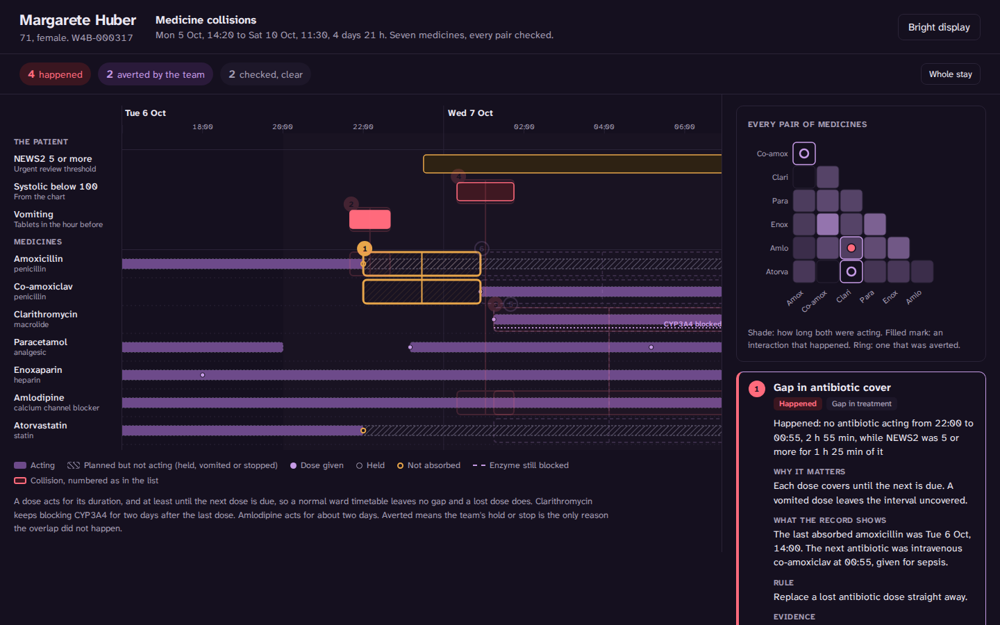

# Medicine collisions

Live: https://med-collisions.vercel.app

Every medicine a patient received, laid out by when it was actually acting rather than when it
was charted. Interactions are marked where they overlapped in time, each one labelled as
having happened, been averted by the team, or been checked and found clear.



Interaction checkers work on lists. They see two drugs on a medicine chart and raise an alert,
whether or not the two were ever in the body at the same time. That alert fires so often it gets
clicked through. This map asks a narrower question: did these two things overlap, for how long,
and did anyone do anything about it?

- **Exposure, not orders.** Each dose acts for its duration, and at least until the next dose is
  due. A normal ward timetable (08:00, 14:00, 22:00) leaves no gap, but a vomited dose does.
  Amlodipine acts for about two days. Clarithromycin keeps blocking the CYP3A4 enzyme for two
  days after its last dose, and that window is drawn on its lane.
- **Happened, averted, clear.** Every collision is computed twice: once on what was given, and
  once on what was due (held doses, vomited doses, and the doses a stopped medicine would have
  continued with). If it overlaps only on what was due, the team's hold or stop prevented it,
  and the map says which one.
- **Conditions are lanes too.** Low blood pressure, vomiting and a NEWS2 of 5 or more come from
  the observation chart. They collide with medicines the same way medicines collide with each
  other.
- **Every pair, shown.** A matrix of all 21 pairs is shaded by how long both drugs were acting
  together and marked where an interaction is known. Pairs that overlapped with no known
  interaction are visible too, so nothing is hidden by omission.



## What it finds in this record

The same fictional patient as the [ward monitor](https://github.com/Henrycarto/ward-monitor),
the [patient timeline](https://github.com/Henrycarto/patient-timeline) and the
[decision cockpit](https://github.com/Henrycarto/decision-cockpit).

| # | Collision | Status | From the record |
|---|---|---|---|
| 1 | Gap in antibiotic cover | Happened | No antibiotic acting from 22:00 to 00:55, 2 h 55 min, and her NEWS2 was 5 or more for 1 h 25 min of it |
| 2 | Oral doses and vomiting | Happened | Amoxicillin and atorvastatin taken within the hour before she vomited; neither was replaced |
| 3 | Clarithromycin and amlodipine | Happened | 1 day 6 h with both acting, 30 min of it with systolic below 100. **No note mentions it.** Holding amlodipine cut it from 2 days 23 h |
| 4 | Amlodipine and low blood pressure | Happened | 1 h 25 min with systolic below 100 while Tuesday's dose was still acting |
| 5 | Clarithromycin and atorvastatin | Averted | The pharmacist's hold avoided 2 days 23 h of overlap; the restart at home falls 21 h after the enzyme block ended |
| 6 | Amoxicillin and co-amoxiclav | Averted | Amoxicillin was stopped as the first co-amoxiclav dose went in |
| 7 | Paracetamol daily limit | Clear | At most 4 g in any 24 hours, doses at least 6 hours apart |
| 8 | Kidney function and doses | Clear | Lowest eGFR 47, above the threshold of 30 where doses change |

Row 3 is the one worth building this for. The team held amlodipine for low blood pressure, which
was right, but the dose given on Tuesday morning was still acting when clarithromycin started,
and clarithromycin raises amlodipine levels. Nothing in the record connects the two. A list-based
checker would have flagged the pair on the chart regardless. This map shows when it was real,
for how long, and how much the hold reduced it.

## How it decides

- **Intervals.** Exposure, conditions and collisions are sets of time intervals. Merge,
  intersect, subtract and gaps are small, pure, tested functions.
- **Exposure.** A given dose acts from its time to whichever is later: its duration, or the next
  due dose (within 1.5 dosing intervals).
- **What was due.** All charted doses, whatever their status, plus one day of doses a stopped
  medicine would have continued with at its usual interval.
- **Averted.** The actual overlap is zero and the overlap on what was due is not. Each
  counterfactual changes one drug at a time, so an averted collision is credited to the hold or
  stop that prevented it.
- **Vomiting.** Oral doses in the hour before vomiting count as not absorbed. The tests check
  that this rule picks out exactly the doses the nurse recorded as not retained.
- **Antibiotic cover.** The union of all antibiotic exposure, with its gaps between the first
  and last dose.
- **Checks.** The highest paracetamol total in any 24 hours, the shortest gap between doses,
  and the lowest eGFR (CKD-EPI 2021) against the renal dosing threshold.

The interaction table is small and curated for this patient's medicines, simplified from
standard references. Each entry carries its mechanism and the action it calls for.

## Tested

103 tests. 46 of them are the shared NEWS2 band edges. The rest cover:

- interval operations
- exposure through the ward timetable, held doses, vomited doses and stopped medicines
- the enzyme-inhibition tail
- every collision's status, interval and wording
- the vomiting rule against the recorded dose statuses
- ordering
- the integrity of every lane, event and interaction reference

The first version of the exposure model treated the overnight interval between 22:00 and 08:00
as a gap in antibiotic cover. It flagged two false gaps in a normal timetable. The rule is now
that a dose covers until the next one is due.

## Design

Same design system as the other three: white, one purple for interaction, Atkinson Hyperlegible
Next bundled with the app. Red marks what happened, purple dashes mark what was averted, amber
hatching marks a gap, and grey marks a check that came back clear. Selecting a collision from the
map, the matrix or the list fades everything else. Zooming eases into the collision's window.
Dim display follows the system or the button. On a phone the map scrolls sideways under fixed
lane labels, and the list sits below.



## Run it

```bash
npm install
npm run dev
npm test && npm run lint && npm run typecheck
npm run build          # static site in dist/
npm run build:single   # one self-contained HTML file in dist-single/
```

`?c=clarithromycin+amlodipine` opens with a collision selected.

## Not a medical device

A fictional patient and a small curated interaction table, for demonstrating interface design
and the logic behind it. It is not prescribing advice, it is not validated, and it must not be
used to make clinical decisions.

## Author

Samuel Henry Mba
